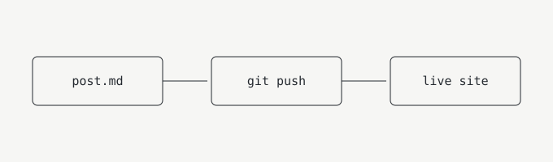

This site is just a folder of Markdown files. Each post lives in `src/content/posts/`.

> Tip: set `draft: true` in a post's frontmatter to hide it from the live site.

## Code

Fenced code blocks get syntax highlighting:

```ts
function greet(name: string) {
  return `hello, ${name}`;
}
```

## Images

Put the image in `src/content/posts/images/` and link to it with a relative path:

```md

```


Astro optimizes images referenced this way and fails the build if the path is wrong, so you never ship a broken image. The text in square brackets is the alt text, which screen readers use.

You can also link to an image hosted elsewhere with its full URL:

```md

```

That's it. Write, commit, push.
