[minidb](https://github.com/abhi-node/minidb) is a relational database engine
written from scratch in C, with nothing underneath it but libc. It parses SQL,
plans it, runs it over B+-trees stored in 4 KB pages, and survives `kill -9`.

This post is the short tour: how a statement travels through it, how the bytes
are laid out, and what the profiler said about making inserts fast.

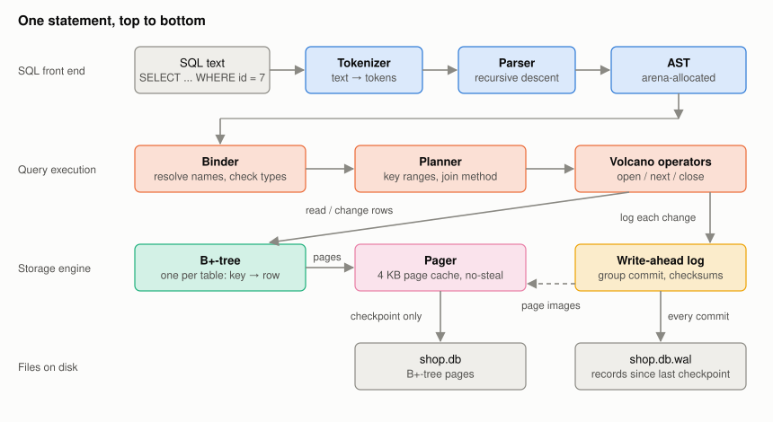

## The query side

The front end is hand-written: a tokenizer that hands out views into the SQL
text, and a recursive-descent parser with one function per precedence level.
The AST lives in an arena that is freed in one call when the statement ends.

Before anything runs, a binder resolves every column name to a position in the
row and gives every expression node a type. `WHERE name > 5` fails there, with
`cannot apply > to TEXT and INT`, so the evaluator never has to check a type.

Execution is the Volcano model. Every operator is an iterator with
`open / next / close`, and rows are pulled from the top one at a time.

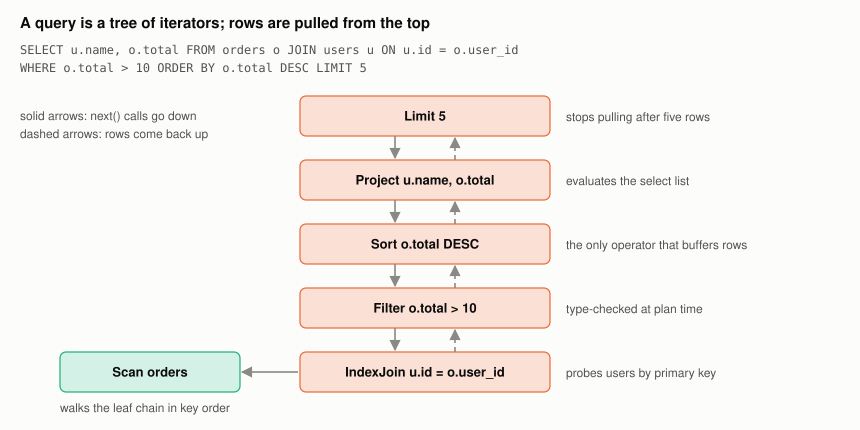

The planner makes two decisions that matter. A comparison between the primary
key and a constant becomes the scan's key range, so `WHERE id = 7` is a single
tree descent. And a join on the right table's primary key becomes an index
join, one probe per left row, instead of a nested loop.

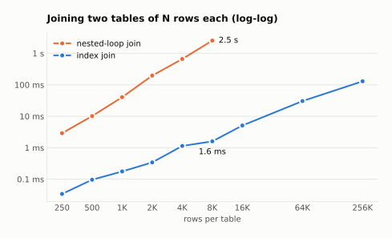

## The storage side

The database file is an array of 4 KB pages. Each table is a B+-tree whose
leaves are slotted pages: a sorted array of 2-byte slots pointing at cells
that stay wherever they landed. Rows are serialized with no padding and read
back in place.

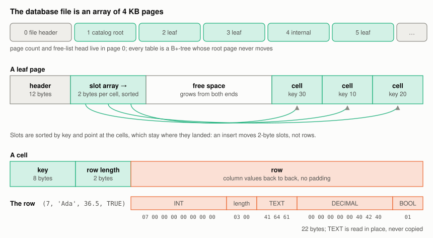

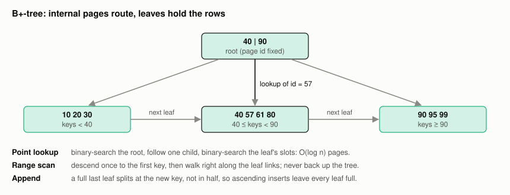

A point lookup reads one page per level: two pages up to 10K rows, three from
100K to 4M.

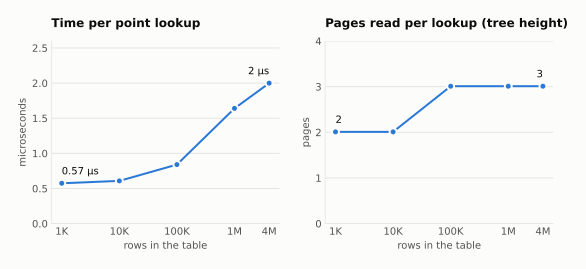

## Making inserts fast

The benchmark is the unkind one: every row is its own SQL statement and its
own commit, and the clock stops only after the last fsync.

The first version did the obvious safe thing and fsynced on every commit. It
managed 5,500 rows a second, and the flamegraph explains why in one colour.

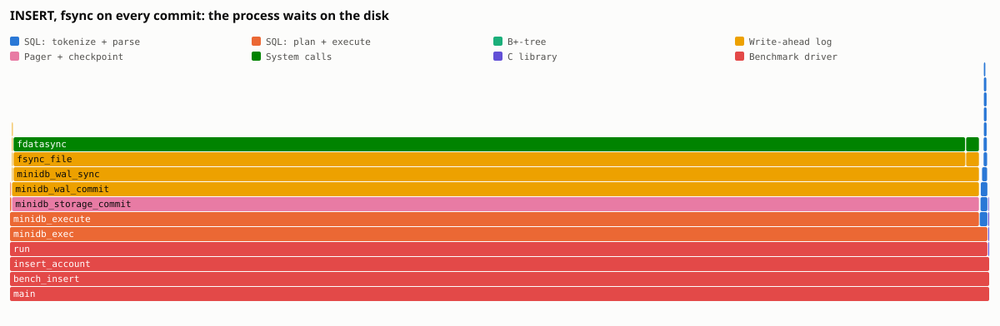

97% of the time is spent waiting for the disk. The fix is group commit:
commits go into an in-memory log buffer, and one fsync covers everything that
arrived in the last 5 ms.

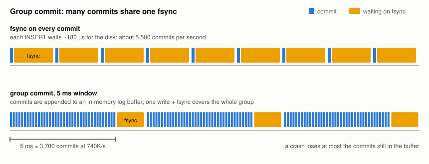

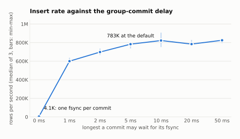

That took the engine to roughly 580K rows a second, and only then did the
profile show the engine itself.

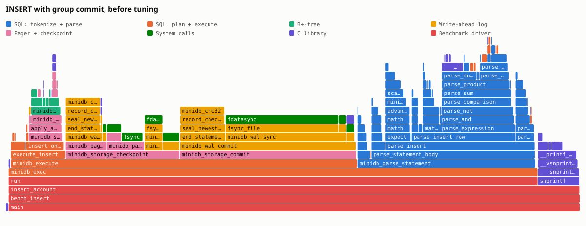

Three things stood out, and each got a small fix:

| What the profile showed | Fix |
|---|---|
| 14% in the CRC-32 that protects log records | Slicing-by-8: eight bytes per loop iteration instead of one |
| 9% recognizing keywords in the tokenizer | Reject on length and first letter before comparing characters |
| With random keys, 86% inside checkpoints | Let dirty pages fill more of a larger cache before checkpointing |

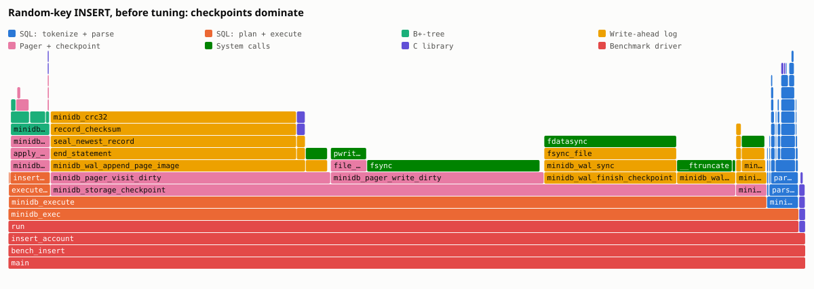

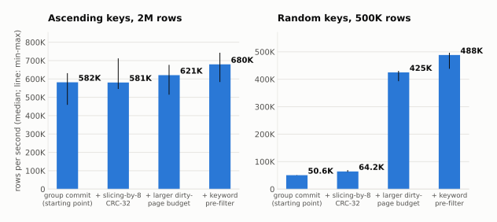

The benchmark machine is a shared 2-vCPU VM, so the ascending-key steps sit
inside the noise individually; the random-key jump (51K to 425K) does not.

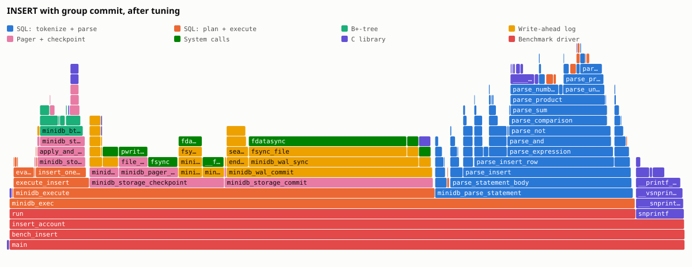

Where it landed:

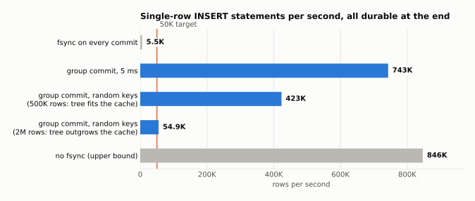

And it holds: ten million inserts in 13.7 seconds, with the dips marking
checkpoints.

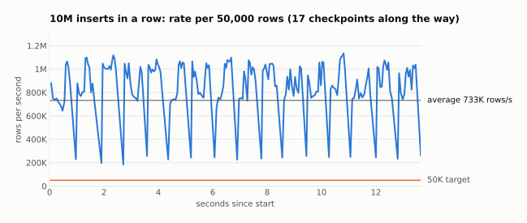

The weak spot is honest too. Random inserts into a tree larger than the cache
are bound by checkpoint I/O, at about 55K rows a second.

## Not losing data

Group commit means a crash can lose the last few milliseconds of commits (the
`FULL` sync mode keeps the fsync-per-commit guarantee). What it must never do
is corrupt what was already there, and that comes down to the checkpoint.

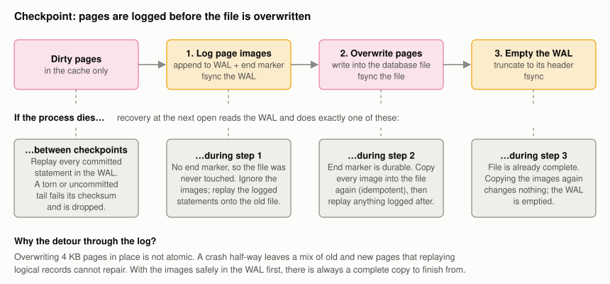

Overwriting pages in place is not atomic, so page images go to the log first.
Whatever step the process dies at, recovery has a complete copy to finish
from. The test suite kills a child process at each of those steps, and with a
torn log tail, then reopens the database and checks every row. All ten test
binaries also run clean under Valgrind.

## What it does not do

One connection, one thread, no multi-statement transactions, no `NULL`, no
secondary indexes, no aggregates. Each of those is a project of its own, and
leaving them out is what let the rest be done properly.

The code, the benchmarks and the longer write-ups are in the
[repository](https://github.com/abhi-node/minidb).
